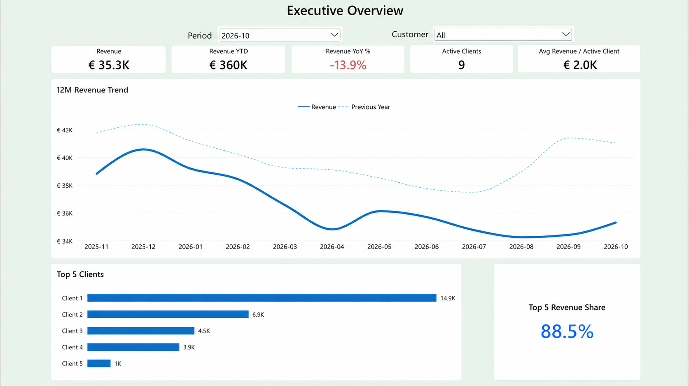
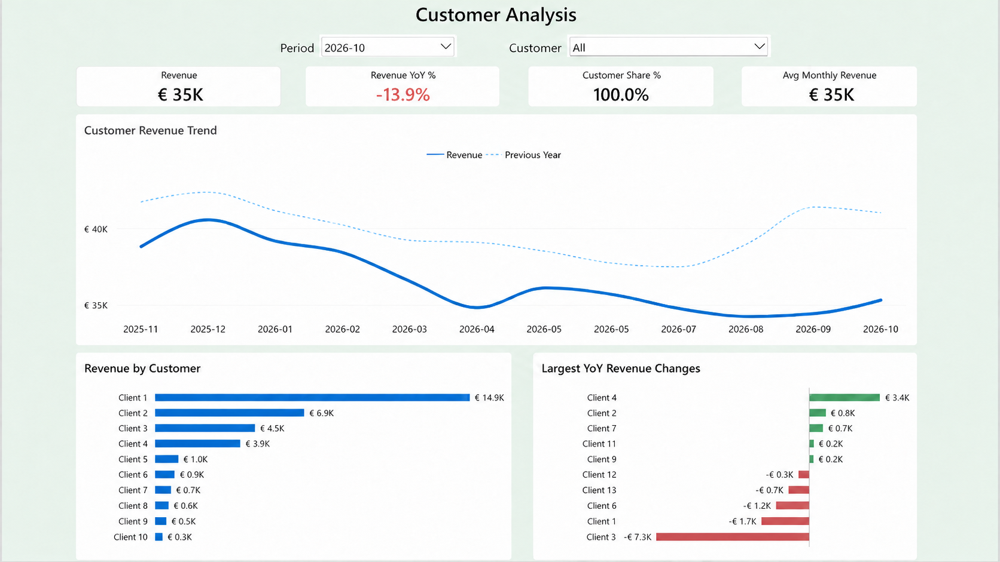
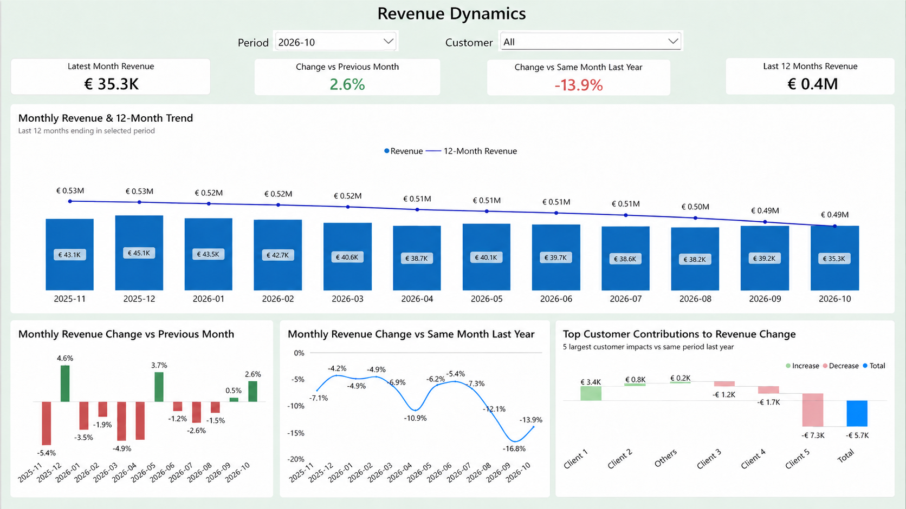
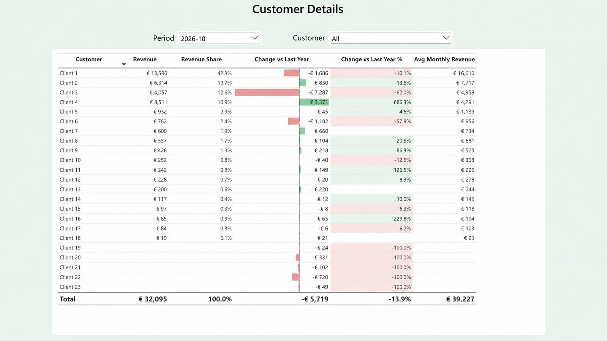

# Revenue Analytics Power BI Dashboard

## Project Overview

This project demonstrates a multi-page Power BI revenue analytics dashboard designed for management and financial analysis.

The dashboard provides a structured view of revenue performance, customer concentration, revenue dynamics, and customer-level changes over time.

The report was built using a dimensional data model and DAX measures for time intelligence, customer analysis, rolling metrics, and contribution analysis.

**Tech Stack:** Power BI · DAX · Power Query · Microsoft Fabric · Direct Lake

> The data shown in the screenshots has been anonymized and modified for portfolio purposes.

---

## Business Goal

The dashboard is designed to answer key management questions:

- How is revenue changing over time?
- How does current revenue compare with the previous year?
- Which customers generate the largest share of revenue?
- Which customers drive positive or negative revenue changes?
- How concentrated is the revenue base?
- What is the detailed performance of each customer?

---

## Dashboard Pages

### 1. Executive Overview

High-level management view of revenue performance.

Key metrics:
- Revenue
- Revenue YTD
- Revenue YoY %
- Active Clients
- Average Revenue per Active Client

Main visuals:
- 12-month revenue trend
- Revenue vs Previous Year
- Top 5 Clients
- Top 5 Revenue Share



---

### 2. Customer Analysis

Customer-level analysis focused on revenue contribution and year-over-year performance.

Key metrics:
- Revenue
- Revenue YoY %
- Customer Share %
- Average Monthly Revenue

Main visuals:
- Customer Revenue Trend
- Revenue by Customer
- Largest YoY Revenue Changes



---

### 3. Revenue Dynamics

Time-based analysis of revenue movements and customer contribution to change.

Key metrics:
- Latest Month Revenue
- Change vs Previous Month
- Change vs Same Month Last Year
- Rolling 12-Month Revenue

Main visuals:
- Monthly Revenue and Rolling 12-Month Trend
- Month-over-Month Revenue Change
- Year-over-Year Revenue Change
- Top Customer Contributions to Revenue Change



---

### 4. Customer Details

Detailed customer-level analytical table.

Metrics include:
- Revenue
- Revenue Share
- Change vs Last Year
- Change vs Last Year %
- Average Monthly Revenue

Conditional formatting is used to highlight positive and negative changes.



---

## Data Model

The report follows a dimensional modelling approach.

Main tables:

- `Fact_Revenue`
- `Dim_Customer`
- `Dim_Customer_Group`
- `Dim_Date`

Core relationships:

- `Dim_Customer_Group` → `Dim_Customer`
- `Dim_Customer` → `Fact_Revenue`
- `Dim_Date` → `Fact_Revenue`

The model supports time intelligence and customer-level analysis while keeping the reporting layer structured and scalable.

---

## Key Measures

Examples of DAX measures used in the report:

- Revenue
- Revenue Previous Year
- Revenue YoY Change
- Revenue YoY %
- Revenue Previous Month
- Revenue MoM %
- Revenue YTD
- Rolling 12M Revenue
- Active Clients
- Average Revenue per Active Client
- Customer Share %
- Average Monthly Revenue
- Top 5 Revenue Share

---

## Data Architecture

The original solution was designed using the following architecture:

```text
Source Data
    ↓
SharePoint
    ↓
Power Query / Dataflow Gen2
    ↓
Microsoft Fabric Lakehouse
    ↓
Direct Lake Semantic Model
    ↓
Power BI Report

---

## Tools & Technologies

- Power BI
- DAX
- Power Query
- Microsoft Fabric
- Dataflow Gen2
- Lakehouse
- Direct Lake
- SharePoint
- Excel

---

## Data Privacy

All customer names and financial values shown in this repository have been anonymized or modified.

The screenshots are intended only to demonstrate the dashboard structure, analytical logic, and visualization approach.
